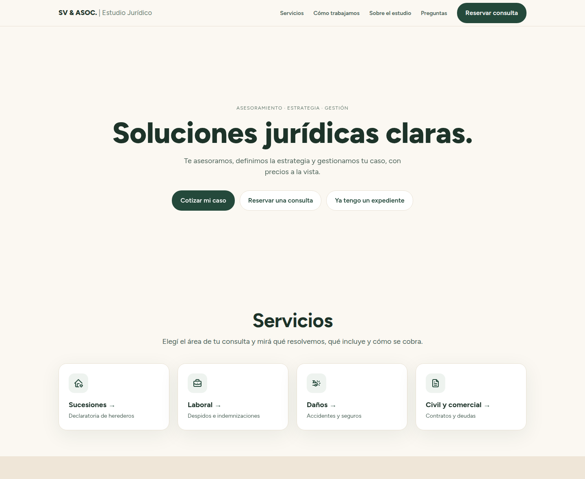

# SV & Asociados · Estudio Jurídico

[](https://github.com/guidotesolin/sv-estudio-juridico/actions/workflows/ci.yml)
[](LICENSE)

El sitio web de un estudio jurídico de Santa Fe, Argentina. Quien llega con un problema concreto
(una herencia, un despido, un accidente, un contrato) entiende qué puede hacer el estudio por él,
**ve un honorario orientativo en pesos y reserva una consulta paga por su cuenta**, sin escribir un
solo mensaje.

**[estudiovidoni.com.ar](https://estudiovidoni.com.ar/)** · English version: [README.md](README.md)

[](https://estudiovidoni.com.ar/)

Hecho para SV & Asociados · Estudio Jurídico (Sabrina Vidoni), Santa Fe.

## Qué hace

Cada consulta empezaba por WhatsApp con el mismo intercambio: qué podés hacer por mí, cuánto
cuesta, cuándo nos vemos. El sitio responde las tres:

- **Cuatro áreas** (sucesiones, laboral, daños, civil y comercial), cada una con la misma
  estructura: qué resuelve, qué incluye, qué documentación traer, cómo se cobra y qué no incluye.
- **Una cotización en cuatro pasos** (`/cotizar`): área, servicio, unas preguntas sobre el caso y
  su situación. El resultado es un monto o un rango en pesos, calculado a partir del honorario en
  **JUS**, la unidad que usa la ley arancelaria de Santa Fe, con lo que incluye y lo que no.
- **Reserva sin backend**: el resultado lleva al evento de Cal.com que corresponde, conectado al
  Google Calendar de la abogada, y pasa el resumen de la cotización a las notas de la reserva, así
  llega adentro del evento del calendario.
- **Una página para expedientes en curso** (`/expediente`), otra sobre el estudio (`/estudio`) y
  preguntas frecuentes (`/preguntas`).

No pide datos personales ni guarda ninguno: la cotización corre en el navegador sin hacer ningún
pedido a la red, y el nombre y el email se cargan en Cal.com, nunca en las URLs del sitio.

## Cómo está hecho

Astro (salida estática) · TypeScript estricto · una isla en TypeScript plano · Cal.com ·
Cloudflare Pages.

Las decisiones que lo definieron, cada una argumentada en
[docs/ARCHITECTURE.md](docs/ARCHITECTURE.md):

- **Nunca se publica un honorario inventado.** Los honorarios viven en `src/data/prices.ts` en
  JUS, y uno que la abogada no confirmó es `null`, que la interfaz muestra como "a confirmar".
  Cuando cambia el valor del JUS, cambia una constante. La estimación es una función pura con un
  smoke check que falla si los pesos dejan de coincidir con los JUS.
- **Sin servidor, sin base de datos, sin formulario.** Una sola isla interactiva hace la
  cotización; la reserva es un link saliente. Nada que parchear, nada que vulnerar, nada que pagar.
- **Sin datos personales en las URLs.** El link de reserva precarga solo el resumen de la
  cotización (`notes`); un smoke check verifica que nunca aparezcan `name=` ni `email=`.
- **Ningún origen de terceros en la página.** La tipografía está alojada en el sitio, Cal.com es
  un link y no un embed, y todo script y hoja de estilos es un archivo externo, así que la Content
  Security Policy es `'self'` para scripts y estilos, sin `'unsafe-inline'`.
- **Sin token de deploy.** Cloudflare Pages compila desde GitHub con su integración de Git; el
  repo no guarda secretos porque no hay ninguno (todos los valores de configuración son públicos).
- **Accesible como un formulario, nativo como una app.** Cada opción de la cotización es un radio
  real con su label y todo el flujo funciona con teclado; el hover solo existe para punteros
  reales y cada control responde al toque.
- Corre solo en planes gratuitos: el único costo es el dominio.

## Documentación

- **[docs/ARCHITECTURE.md](docs/ARCHITECTURE.md)**: el diseño y su razonamiento. Empezá por acá.
- **[docs/TASKS.md](docs/TASKS.md)**: el tablero de tareas, una rama por tarea, con criterios de
  aceptación, y el backlog de lo que se dejó afuera a propósito.

La documentación técnica está en inglés.

## Para empezar

Requiere la versión de Node de `.nvmrc` (la LTS actual; `nvm use` la toma).

```bash
nvm use
npm ci
git config core.hooksPath .githooks
npm run dev
```

La línea de los hooks activa el pre-commit, que rechaza archivos `.env` y corre
[gitleaks](https://github.com/gitleaks/gitleaks) si está instalado. El sitio no necesita variables
de entorno.

## Scripts

| Script                            | Qué hace                                                      |
| --------------------------------- | ------------------------------------------------------------- |
| `npm run dev`                     | Servidor de desarrollo                                        |
| `npm run build`                   | Build estático en `dist/`                                     |
| `npm run preview`                 | Sirve el build                                                |
| `npm run lint`                    | ESLint y después Oxlint con las reglas anti-slop del repo     |
| `npm run format` / `format:check` | Prettier: escribe / verifica                                  |
| `npm run check`                   | `astro check` (tipos)                                         |
| `npm run quote:smoke`             | Verifica la tabla de honorarios y la estimación               |
| `npm run booking:smoke`           | Verifica el link de reserva: solo notas, sin datos personales |

## Cómo se trabajó

- `main` tiene el esqueleto. Cada tarea sale de ahí en su rama: `t1-design-system`, `t2-home`,
  etc. Cada tarjeta de `docs/TASKS.md` define alcance, dependencias y criterios de aceptación.
- **Asistido por IA, revisado por una persona.** Cada tarea se hizo con Claude Code en una sesión
  independiente que lee `docs/ARCHITECTURE.md` y su tarjeta, y nada más. Claude no commitea:
  propone el mensaje de commit y la descripción del ticket, y el mantenedor revisa cada diff y
  corre el commit.
- El código se escribe con el plugin `ponytail`: YAGNI, librería estándar antes que dependencias,
  el diff más corto que funcione. Los atajos deliberados llevan un comentario `ponytail:` con su
  límite y la salida.
- El lint incluye [anti-slop](https://github.com/dmmulroy/anti-slop), reglas de Oxlint copiadas en
  `tools/oxlint/anti-slop/`: nada de casts sin justificar ni tipos sin evidencia.
- Código, identificadores, commits y documentación en inglés; los textos del sitio en español
  rioplatense.
- CI corre lint, Prettier, `astro check`, los dos smoke checks y un build de producción en cada
  push y pull request. Dependabot mantiene al día npm y GitHub Actions.

## Deploy

Los pasos de deploy en Cloudflare Pages están en la [versión en inglés](README.md#deploy).

## Licencia

El código fuente es [MIT](LICENSE). El nombre del estudio, sus marcas, el retrato, los textos y los
honorarios no lo son: ver la nota al final de la licencia.
