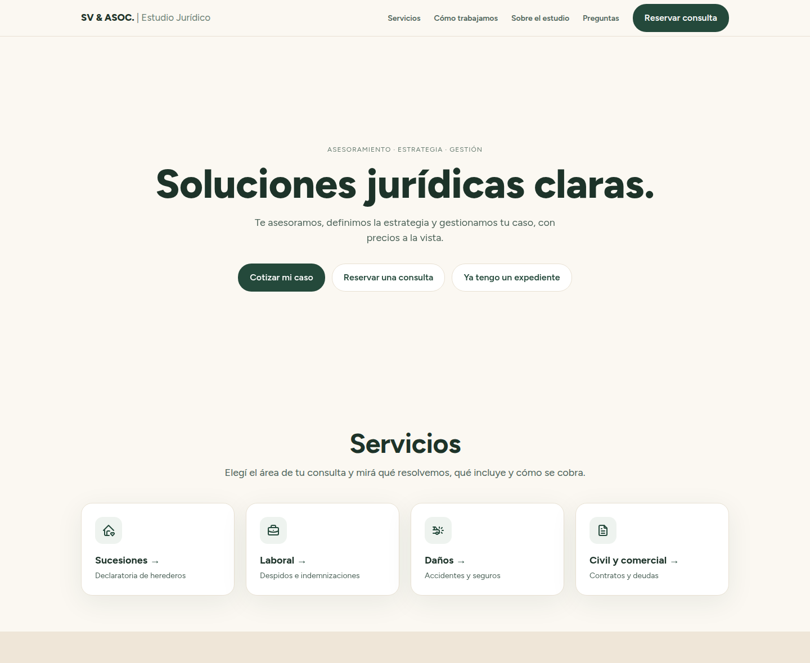

# SV & Asociados · Estudio Jurídico

[](https://github.com/guidotesolin/sv-estudio-juridico/actions/workflows/ci.yml)
[](LICENSE)

The website of a law practice in Santa Fe, Argentina. A visitor arrives with a concrete problem (an
inheritance, a dismissal, an accident, a contract), understands what the firm can do for them,
**sees an indicative fee in pesos, and books a paid consultation on their own** — without writing
a single message.

**[estudiovidoni.com.ar](https://estudiovidoni.com.ar/)** · Versión en español:
[README.es.md](README.es.md)

[](https://estudiovidoni.com.ar/)

Built for SV & Asociados · Estudio Jurídico (Sabrina Vidoni), Santa Fe.

## What it does

Every inquiry used to start on WhatsApp with the same exchange: what can you do for me, how much
does it cost, when can we meet. The site answers the three:

- **Four practice areas** — successions, labor, damages, civil and commercial — each with a fixed
  structure: what it solves, what's included, documentation to bring, how it's charged, what's not
  included.
- **A quote in four steps** (`/cotizar`): area, service, a few questions about the case, and its
  situation. The result is an amount or a range in pesos, computed from the fee in **JUS**, the
  unit Santa Fe's fee law uses, with what's included and what isn't.
- **Booking without a backend**: the result links to the right Cal.com event, connected to the
  lawyer's Google Calendar, and carries the quote summary into the booking's notes, so it arrives
  inside the calendar event.
- **A page for ongoing cases** (`/expediente`), about the firm (`/estudio`) and an FAQ
  (`/preguntas`).

It asks for no personal data and stores none: the quote runs in the browser, makes no network
request, and the visitor types their name and email in Cal.com, never in the site's URLs.

## How it is built

Astro (static output) · TypeScript strict · one island in plain TypeScript · Cal.com · Cloudflare
Pages.

The decisions that shaped it, each argued in [docs/ARCHITECTURE.md](docs/ARCHITECTURE.md):

- **No invented fee ever ships.** Fees live in `src/data/prices.ts` as JUS, and a fee the lawyer
  hasn't confirmed is `null`, which the UI shows as "a confirmar". When the JUS value changes, one
  constant changes. The estimate is a pure function with a smoke check that fails if the pesos
  stop matching the JUS.
- **No server, no database, no form.** One interactive island does the quote; booking is an
  outbound link. Nothing to patch, nothing to breach, nothing to pay.
- **No personal data in URLs.** The booking link prefills only the quote summary (`notes`); a
  smoke check asserts that `name=` and `email=` never appear in it.
- **No third-party origin on the page.** The font is self-hosted, Cal.com is a link and not an
  embed, and every script and stylesheet is an external file, so the Content Security Policy is
  `'self'` for scripts and styles alike, with no `'unsafe-inline'`.
- **No deploy token.** Cloudflare Pages builds from GitHub through its Git integration; the repo
  holds no secret because there is none (every configuration value is public).
- **Accessible as a form, native as an app.** Every option in the quote is a real radio input with
  a label and the whole flow works from the keyboard; hover only exists for real pointers, and
  every control has press feedback on touch.
- Runs on free tiers only: the domain is the one cost.

## Documentation

- **[docs/ARCHITECTURE.md](docs/ARCHITECTURE.md)** — the design and its reasoning. Read this first.
- **[docs/TASKS.md](docs/TASKS.md)** — the task board, one branch per task, with acceptance
  criteria, and the backlog of what was deliberately left out.

## Getting started

Requires Node from `.nvmrc` (current LTS; `nvm use` picks it up).

```bash
nvm use
npm ci
git config core.hooksPath .githooks
npm run dev
```

The hooks line enables the pre-commit hook, which refuses `.env` files and runs
[gitleaks](https://github.com/gitleaks/gitleaks) when it is installed. The site needs no
environment variables.

## Scripts

| Script                            | Does                                                  |
| --------------------------------- | ----------------------------------------------------- |
| `npm run dev`                     | Dev server                                            |
| `npm run build`                   | Static build into `dist/`                             |
| `npm run preview`                 | Serve the build                                       |
| `npm run lint`                    | ESLint, then Oxlint with the vendored anti-slop rules |
| `npm run format` / `format:check` | Prettier write / check                                |
| `npm run check`                   | `astro check` (types)                                 |
| `npm run quote:smoke`             | Check the fee table and the estimate                  |
| `npm run booking:smoke`           | Check the booking link: notes only, no personal data  |

## Development workflow

- `main` holds the skeleton. Every task branches off it: `t1-design-system`, `t2-home`, etc. Each
  card in `docs/TASKS.md` states scope, dependencies and acceptance criteria.
- **AI-assisted, human-reviewed.** Each task was executed with Claude Code in an independent
  session that reads `docs/ARCHITECTURE.md` and its card and nothing else. Claude does not commit:
  it proposes the commit message and the ticket description, and the maintainer reviews every
  diff and runs the commit.
- Code is written with the `ponytail` plugin: YAGNI, stdlib before dependency, the shortest diff
  that works. Deliberate shortcuts carry a `ponytail:` comment with their ceiling and way out.
- Lint includes [anti-slop](https://github.com/dmmulroy/anti-slop), a set of Oxlint rules copied
  into `tools/oxlint/anti-slop/`: no unjustified casts, no types without evidence.
- Code, identifiers, commits and documentation in English; the site's copy in Argentine Spanish.
- CI runs lint, Prettier, `astro check`, both smoke checks and a production build on every push
  and pull request. Dependabot keeps npm and GitHub Actions current.

## Deploy

Cloudflare Pages builds the site from GitHub through its Git integration, so there is no deploy
token anywhere. One-time setup in the Cloudflare dashboard:

1. **Workers & Pages → Create → Pages → Connect to Git**, authorize the Cloudflare GitHub app for
   this repository only, and pick it.
2. Production branch: `main`. Framework preset: Astro. Build command: `npm run build`. Build
   output directory: `dist`. No environment variables: the build image reads the Node version
   from `.nvmrc`, so don't set `NODE_VERSION` (it would override `.nvmrc` and drift from it).
3. Save and deploy. Every push to `main` deploys production; every PR gets a preview URL.
4. **Custom domains → Set up a custom domain** → `estudiovidoni.com.ar`, then the same for
   `www.estudiovidoni.com.ar`. This needs the domain's DNS on Cloudflare: add the site to
   Cloudflare and replace the nameservers at NIC Argentina with the two Cloudflare gives
   (backlog B5).
5. A custom domain only serves the site, it doesn't redirect, so `www` would be a duplicate. In
   the domain's zone: **Rules → Redirect Rules → Create rule** → template "Redirect from WWW to
   root", status 301, preserve query string.

`public/_headers` sets the security headers (CSP, HSTS and the rest). `robots.txt` is generated
from `site` in `astro.config.mjs` (`src/pages/robots.txt.ts`) and points to the sitemap that
`@astrojs/sitemap` writes at build time, so a domain change is that one line.

After the first deploy, check [securityheaders.com](https://securityheaders.com) (grade A or
better), Lighthouse on `/` and `/cotizar`, and the browser console while completing a quote (no
CSP violations).

## License

The source code is [MIT](LICENSE). The firm's name, marks, portrait, copy and fees are not: see
the note at the end of the license.
